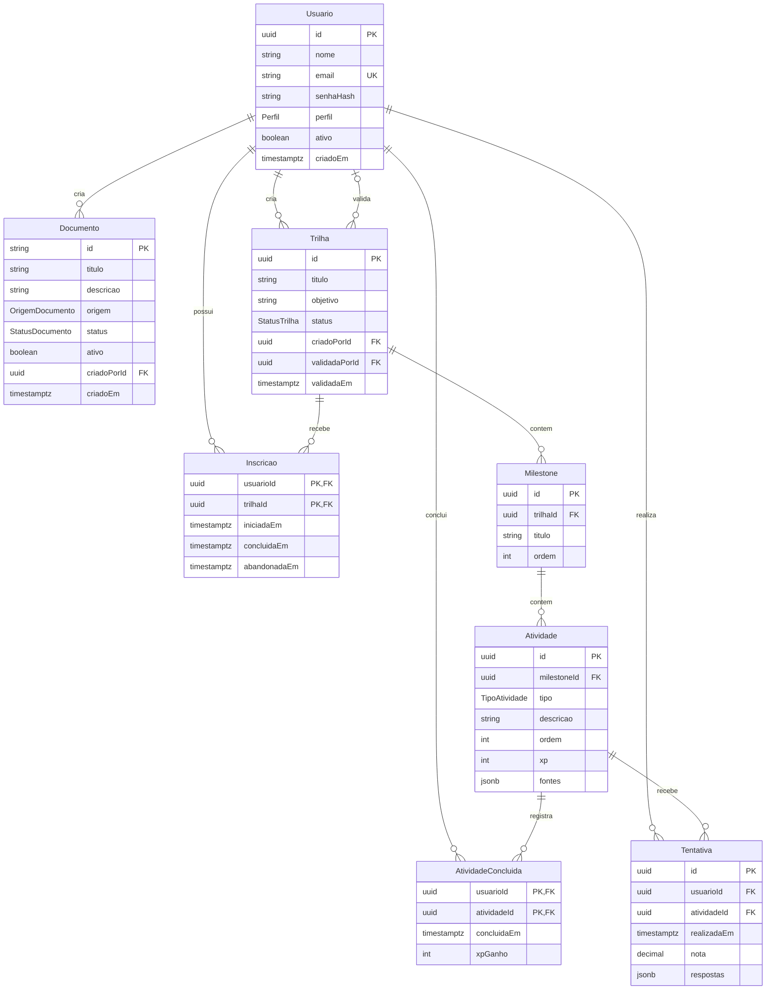

# backend/

API pública, autenticação, persistência, regras de negócio e gamificação do Projeto Horizonte. É o único módulo que o Frontend chama e o único que chama a IA.

## Stack

| Camada | Escolha |
|---|---|
| Linguagem e servidor | Node.js 24, TypeScript (ESM), Express 5 |
| Banco de dados | PostgreSQL (Neon) em `DATABASE_URL`, o mesmo em que a IA guarda os vetores |
| ORM e migrações | Prisma ORM e Prisma Migrate (7.10) |
| Validação e segurança | Zod (entrada e variáveis de ambiente), JWT (`JWT_SECRET`) e bcrypt (senhas) |
| Documentação da API | Swagger / OpenAPI em `/docs`, mantida em `src/openapi.ts` |
| Testes | Vitest e Supertest |
| Deploy | [Render](https://render.com/) |

A spec de um endpoint é escrita **antes** na Issue, seguindo o modelo da seção "Integração". Depois de implementado, ele entra no `src/openapi.ts` e aparece no Swagger, que passa a ser a referência do endpoint pronto.

## Estrutura

```text
backend/
├── src/
│   ├── app.ts          # Cria o app Express e registra as rotas
│   ├── server.ts       # Sobe o servidor na BACKEND_PORT
│   ├── config.ts       # Variáveis de ambiente validadas com Zod
│   ├── erros.ts        # AppError e o formato de erro comum
│   └── openapi.ts      # Documentação servida em /docs
├── test/               # Testes (Vitest + Supertest), um arquivo por assunto
├── prisma/
│   ├── schema.prisma   # Modelos do banco
│   └── migrations/     # Migrações versionadas do Prisma
└── prisma.config.ts    # Conexão do Prisma (lê o .env da raiz)
```

## Modelo de dados

O modelo relacional está em [`prisma/schema.prisma`](prisma/schema.prisma) e a primeira migração em [`prisma/migrations/`](prisma/migrations). O dicionário de dados, as regras de negócio e as restrições estão em [`docs/modelo-dados-horizonte.md`](../docs/modelo-dados-horizonte.md).



## Execução e testes

Pré-requisito: [Node.js](https://nodejs.org/) 24 ou mais recente. As variáveis vêm do `.env` da **raiz** do repositório (`cp .env.example .env`); preencha pelo menos `DATABASE_URL` com a conexão do banco compartilhado (passo a passo no [README](../README.md#como-obter-os-valores-do-neon-e-do-openrouter)).

```bash
cd backend
npm install
npm run dev          # http://localhost:8000/health e http://localhost:8000/docs
npm test             # testes (não precisam do banco)
npm run typecheck    # checagem de tipos
npm run db:migrate   # SÓ o responsável pelo banco, na dev-banco: cria e aplica migrações
# A production recebe as migrações pelo CI, depois do merge (workflow Migrações, README §4).
npm run build && npm start   # versão compilada, como no deploy
```

**Teste os endpoints pelo Swagger:** com o servidor no ar, abra `http://localhost:8000/docs`, escolha o endpoint, clique em **Try it out** e depois em **Execute**. Funciona em qualquer sistema e mostra a requisição e a resposta.

**Para criar um endpoint:** escreva o teste em `test/`, implemente a rota em `src/app.ts` (ou em um arquivo de rotas importado por ele), valide a entrada com Zod, lance `AppError` para erros esperados e documente o endpoint em `src/openapi.ts`.

## Integração (template)

**Frontend → Backend**, HTTP/JSON. Cada endpoint novo é especificado com o modelo abaixo na seção "Integração" da Issue (fase "Especificar" do SDD) e revisado pelo Frontend. O que todos os módulos usam, como o `GET /health` e o formato de erro, fica registrado aqui.

### Modelo de endpoint

````markdown
### `MÉTODO /caminho`

O que faz e quem pode chamar (colaborador, gestor, administrador).

Autenticação: pública ou JWT (`Authorization: Bearer <token>`); perfis permitidos.

Requisição:
```json
{ "campo": "valor" }
```

Resposta `200`:
```json
{ "campo": "valor" }
```

Erros: `400` (...), `401` (...), `404` (...).
````

### `GET /health`

Resposta `200`:

```json
{ "status": "ok" }
```

### Formato de erro comum

Usado pelo Backend e pela IA em toda resposta com status `4xx` ou `5xx`:

```json
{
  "erro": {
    "codigo": "DOCUMENTO_NAO_ENCONTRADO",
    "mensagem": "Texto legível para o usuário.",
    "detalhes": {}
  }
}
```

`codigo` é estável e em `MAIUSCULAS_COM_SUBLINHADO`; o Frontend decide o que mostrar a partir dele, não da `mensagem`. Mudar ou remover um campo de um endpoint já usado exige revisão das equipes afetadas.
