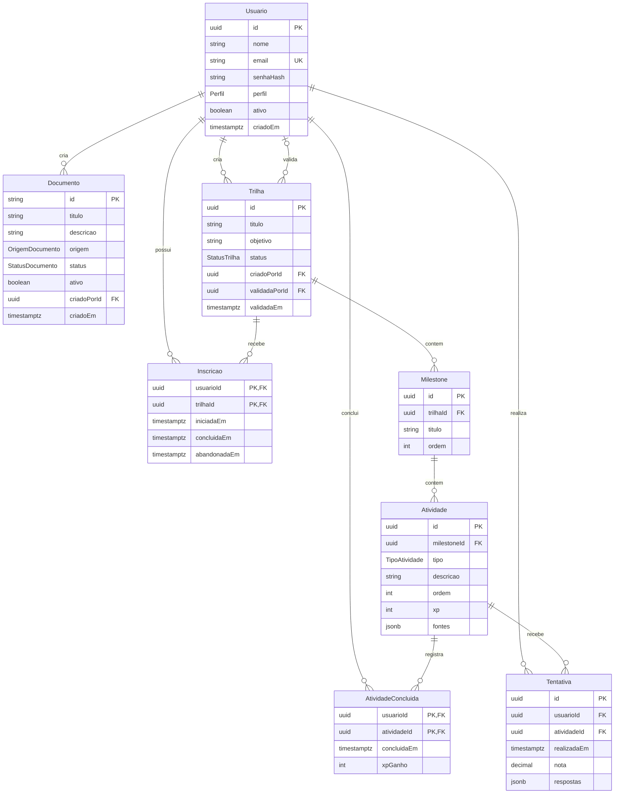

# Projeto Horizonte — Modelo de Dados Relacional

**Versão:** 1.3 — 09/11/2026  
**Banco:** PostgreSQL (Neon)  
**ORM:** Prisma  
**Referência:** Issue #40

## 1. Estrutura

O modelo possui oito entidades: `Usuario`, `Documento`, `Trilha`, `Milestone`, `Atividade`, `Inscricao`, `AtividadeConcluida` e `Tentativa`.

As tabelas da aplicação pertencem ao schema `public`. O schema `rag` e a tabela `rag.data_chunks` não devem ser alterados. `Documento.id` é `TEXT`, compatível com `documento_id` do serviço de IA. As demais entidades principais utilizam UUID; `Inscricao` e `AtividadeConcluida` utilizam chaves primárias compostas.

## 2. Diagrama ER



## 3. Dicionário de dados

### Usuario

| Campo | Tipo PostgreSQL | Restrições |
|---|---|---|
| id | UUID | PRIMARY KEY, DEFAULT UUID gerado pelo Prisma |
| nome | VARCHAR(150) | NOT NULL |
| email | VARCHAR(254) | NOT NULL, UNIQUE |
| senhaHash | TEXT | NOT NULL |
| perfil | Perfil | NOT NULL |
| ativo | BOOLEAN | NOT NULL, DEFAULT TRUE |
| criadoEm | TIMESTAMPTZ | NOT NULL, DEFAULT CURRENT_TIMESTAMP |

### Documento

| Campo | Tipo PostgreSQL | Restrições |
|---|---|---|
| id | TEXT | PRIMARY KEY, fornecido pelo backend |
| titulo | VARCHAR(255) | NOT NULL |
| descricao | TEXT | NULL |
| origem | OrigemDocumento | NOT NULL |
| status | StatusDocumento | NOT NULL |
| ativo | BOOLEAN | NOT NULL, DEFAULT TRUE |
| criadoPorId | UUID | NOT NULL, FOREIGN KEY (Usuario.id), ON DELETE RESTRICT |
| criadoEm | TIMESTAMPTZ | NOT NULL, DEFAULT CURRENT_TIMESTAMP |

### Trilha

| Campo | Tipo PostgreSQL | Restrições |
|---|---|---|
| id | UUID | PRIMARY KEY, DEFAULT UUID gerado pelo Prisma |
| titulo | VARCHAR(255) | NOT NULL |
| objetivo | TEXT | NOT NULL |
| status | StatusTrilha | NOT NULL, DEFAULT 'RASCUNHO' |
| criadoPorId | UUID | NOT NULL, FOREIGN KEY (Usuario.id), ON DELETE RESTRICT |
| validadaPorId | UUID | NULL, FOREIGN KEY (Usuario.id), ON DELETE RESTRICT |
| validadaEm | TIMESTAMPTZ | NULL |

### Milestone

| Campo | Tipo PostgreSQL | Restrições |
|---|---|---|
| id | UUID | PRIMARY KEY, DEFAULT UUID gerado pelo Prisma |
| trilhaId | UUID | NOT NULL, FOREIGN KEY (Trilha.id), ON DELETE CASCADE |
| titulo | VARCHAR(255) | NOT NULL |
| ordem | INTEGER | NOT NULL, UNIQUE (trilhaId, ordem), CHECK (ordem > 0) |

### Atividade

| Campo | Tipo PostgreSQL | Restrições |
|---|---|---|
| id | UUID | PRIMARY KEY, DEFAULT UUID gerado pelo Prisma |
| milestoneId | UUID | NOT NULL, FOREIGN KEY (Milestone.id), ON DELETE CASCADE |
| tipo | TipoAtividade | NOT NULL |
| descricao | TEXT | NOT NULL |
| ordem | INTEGER | NOT NULL, UNIQUE (milestoneId, ordem), CHECK (ordem > 0) |
| xp | INTEGER | NOT NULL, CHECK (xp >= 0) |
| fontes | JSONB | NOT NULL, DEFAULT '[]'::jsonb |

### Inscricao

| Campo | Tipo PostgreSQL | Restrições |
|---|---|---|
| usuarioId | UUID | PRIMARY KEY (composta), FOREIGN KEY (Usuario.id), ON DELETE RESTRICT |
| trilhaId | UUID | PRIMARY KEY (composta), FOREIGN KEY (Trilha.id), ON DELETE RESTRICT |
| iniciadaEm | TIMESTAMPTZ | NOT NULL, DEFAULT CURRENT_TIMESTAMP |
| concluidaEm | TIMESTAMPTZ | NULL |
| abandonadaEm | TIMESTAMPTZ | NULL |

**PRIMARY KEY:** (`usuarioId`, `trilhaId`).

### AtividadeConcluida

| Campo | Tipo PostgreSQL | Restrições |
|---|---|---|
| usuarioId | UUID | PRIMARY KEY (composta), FOREIGN KEY (Usuario.id), ON DELETE RESTRICT |
| atividadeId | UUID | PRIMARY KEY (composta), FOREIGN KEY (Atividade.id), ON DELETE RESTRICT |
| concluidaEm | TIMESTAMPTZ | NOT NULL, DEFAULT CURRENT_TIMESTAMP |
| xpGanho | INTEGER | NOT NULL, CHECK (xpGanho >= 0) |

**PRIMARY KEY:** (`usuarioId`, `atividadeId`). Não possui `tentativaId`.

### Tentativa

| Campo | Tipo PostgreSQL | Restrições |
|---|---|---|
| id | UUID | PRIMARY KEY, DEFAULT UUID gerado pelo Prisma |
| usuarioId | UUID | NOT NULL, FOREIGN KEY (Usuario.id), ON DELETE RESTRICT |
| atividadeId | UUID | NOT NULL, FOREIGN KEY (Atividade.id), ON DELETE RESTRICT |
| realizadaEm | TIMESTAMPTZ | NOT NULL, DEFAULT CURRENT_TIMESTAMP |
| nota | DECIMAL(4,2) | NULL, CHECK (nota BETWEEN 0 AND 10) |
| respostas | JSONB | NULL |

## 4. Enums

| Enum | Valores |
|---|---|
| Perfil | COLABORADOR, GESTOR, ADMIN |
| OrigemDocumento | AUTORIZADO, SINTETICO, ANONIMIZADO |
| StatusDocumento | PENDENTE, INDEXADO, ERRO |
| StatusTrilha | RASCUNHO, EM_REVISAO, PUBLICADA, ARQUIVADA |
| TipoAtividade | LEITURA, QUIZ, REFLEXAO |

## 5. Integridade referencial

| Entidade filha | Chave estrangeira | Entidade referenciada | ON DELETE |
|---|---|---|---|
| Documento | criadoPorId | Usuario | RESTRICT |
| Trilha | criadoPorId | Usuario | RESTRICT |
| Trilha | validadaPorId | Usuario | RESTRICT |
| Milestone | trilhaId | Trilha | CASCADE |
| Atividade | milestoneId | Milestone | CASCADE |
| Inscricao | usuarioId | Usuario | RESTRICT |
| Inscricao | trilhaId | Trilha | RESTRICT |
| AtividadeConcluida | usuarioId | Usuario | RESTRICT |
| AtividadeConcluida | atividadeId | Atividade | RESTRICT |
| Tentativa | usuarioId | Usuario | RESTRICT |
| Tentativa | atividadeId | Atividade | RESTRICT |

O backend permite exclusão física apenas de trilhas em `RASCUNHO` sem inscrições ou histórico associado. A exclusão de milestones e atividades por cascata não pode eliminar tentativas ou conclusões existentes. A aplicação também bloqueia exclusões e alterações de conteúdo em trilhas `PUBLICADA` e `ARQUIVADA`.

## 6. Regras de negócio

1. **Usuários:** um perfil por usuário. `ADMIN` possui as permissões de `GESTOR`. Usuários inativos não podem fazer login. Usuários não são excluídos fisicamente.
2. **Documentos:** documentos inativos não podem ser usados em novas trilhas. Atualizações de PDFs geram novos documentos com novos IDs; as versões antigas permanecem armazenadas.
3. **Trilhas:** `RASCUNHO` e `EM_REVISAO` permitem edição. `PUBLICADA` e `ARQUIVADA` têm conteúdo e estrutura congelados. Alterações exigem nova trilha. O arquivamento impede novas inscrições, mas permite que inscritos existentes concluam suas atividades.
4. **Validação:** apenas `GESTOR` ou `ADMIN` valida uma trilha. `validadaPorId` e `validadaEm` são preenchidos em conjunto.
5. **Milestones e atividades:** cada atividade pertence a um milestone. A ordem é única dentro do respectivo agrupamento. As fontes de atividades ficam em JSONB com `documento_id`, página e trecho, sem FK direta para `Documento`.
6. **Inscrições:** uma inscrição por usuário e trilha. Uma inscrição abandonada não permite novas tentativas ou conclusões até ser retomada; na retomada, `abandonadaEm` volta a `NULL`. Uma inscrição concluída não permite novas tentativas.
7. **Tentativas:** cada realização gera um registro, inclusive repetições. A nota é opcional, entre 0 e 10, com duas casas decimais. O backend verifica se o usuário está inscrito na trilha da atividade e se a inscrição está em andamento.
8. **Conclusões e XP:** `AtividadeConcluida` registra somente a primeira conclusão. `xpGanho` preserva o XP concedido naquele momento. Tentativas posteriores não geram XP adicional. Gravar tentativa e primeira conclusão de forma transacional, tratando concorrência.
9. **Publicação:** o backend verifica a validação da trilha e os requisitos mínimos de conteúdo antes de publicar.

## 7. Restrições CHECK

As restrições abaixo devem ser incluídas nas migrações SQL versionadas pelo Prisma. São expressões de referência; os comandos `ALTER TABLE` devem utilizar os nomes físicos definidos no schema.

```sql
-- Inscricao: conclusão e abandono mutuamente exclusivos
CHECK ("concluidaEm" IS NULL OR "abandonadaEm" IS NULL)

-- Inscricao: datas não anteriores ao início
CHECK ("concluidaEm" IS NULL OR "concluidaEm" >= "iniciadaEm")
CHECK ("abandonadaEm" IS NULL OR "abandonadaEm" >= "iniciadaEm")

-- Milestone e Atividade: ordem positiva
CHECK ("ordem" > 0)

-- Atividade e AtividadeConcluida: XP não negativo
CHECK ("xp" >= 0)
CHECK ("xpGanho" >= 0)

-- Tentativa: nota de 0 a 10; NULL é permitido
CHECK ("nota" BETWEEN 0 AND 10)

-- Trilha: validador e data preenchidos em conjunto
CHECK (("validadaPorId" IS NULL) = ("validadaEm" IS NULL))

-- Atividade: fontes devem ser um array JSON
CHECK (jsonb_typeof("fontes") = 'array')
```

## 8. Implementação

1. Implementar entidades, enums, relações, índices e restrições no `backend/prisma/schema.prisma`.
2. Executar `npx prisma validate` e gerar a migração pelo fluxo do projeto.
3. Incluir as restrições `CHECK` necessárias no SQL da migração e revisar o resultado.
4. Aplicar a migração somente na branch Neon `dev-banco` durante o desenvolvimento. Não criar tabelas manualmente no SQL Editor.
5. Verificar no PostgreSQL as PKs, FKs, índices, tipos, defaults, nulabilidade e ações `ON DELETE`.
6. Implementar e testar as regras de negócio no backend.
7. Versionar `backend/prisma/migrations/`, atualizar `backend/README.md` com o ER e abrir o Pull Request.
8. Após integração e autorização de deploy, aplicar em `production` com `npx prisma migrate deploy`.

**Observações de implementação:** os critérios de conclusão de `LEITURA`, `QUIZ` e `REFLEXAO`, a estrutura mínima de uma trilha publicável e as transições de revisão devem ser definidos nos fluxos de aplicação. As restrições de status e elegibilidade não são garantidas apenas pelas FKs.
